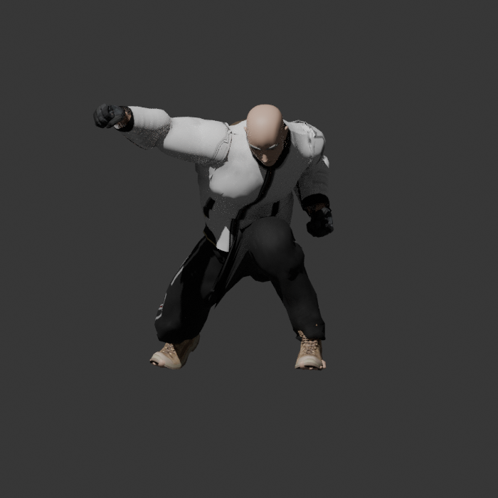
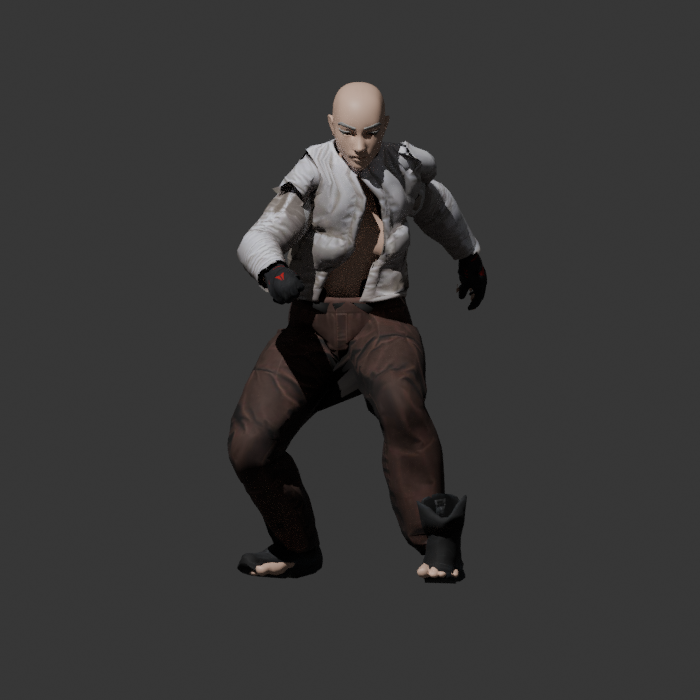

# Ajuste de ropa al cuerpo y a las animaciones

Corrección sobre Vértice v0.22, commit de origen `1f6ffa721cbadd1069f401bc899a57a1b57131c9`.

El catálogo mantiene sus 50 prendas: 33 variantes masculinas y 50 femeninas. Los archivos GLB y las máscaras de cobertura están en `client/public/models/prendas/`.

## Cambios

- Se alinean las mangas con hombro, codo y muñeca del cuerpo. Las mangas que no rodeaban el brazo se retopologizan sobre su superficie, conservando los materiales y proyectando las UV del recurso original.
- Se redistribuyen los pesos con interpolación baricéntrica y un máximo de cuatro huesos por vértice. Las prendas se unen al mismo esqueleto que anima la piel; no quedan huesos de otro personaje moviendo la ropa.
- Los guantes se orientan por mano. Los guantes de nudillos se retopologizan sobre los dedos para que puedan cerrarse.
- Las faldas comparten el movimiento de ambas piernas, con una parte del peso en la cadera. Se han separado los dos objetos del archivo original de faldas: antes se habían mezclado piezas de ambos modelos.
- Se limita la cobertura del cuerpo por tipo de prenda y por proximidad. Un cuello no oculta la cara y una chaqueta corta no oculta los muslos.
- Cascos y máscaras usan las mismas deformaciones de cabeza que la cara personalizada.
- Mientras se descarga una prenda, permanece la ropa anterior en ese hueco.

Los créditos y licencias se conservan en `CREDITOS.md`. Los originales descargados no se añaden al proyecto. `client/public/models/prendas/ajuste-v2.json` registra la base, los hashes y la procedencia de las faldas.

## Comprobación

- `npm run typecheck`: correcto.
- `npm test -- --run client/test/garments.test.ts server/test/v22.test.ts shared/test/content.test.ts`: 92 pruebas correctas.
- `npm run build -w client`: correcto.
- Renderizado de comprobación con Blender 4.3.2: reposo, zancada y las animaciones reales `Melee_Hook` y `Sword_Block` de `ual2.glb`.

Las pruebas del cliente comprueban los 83 GLB: máscaras del tamaño correcto, pesos normalizados, índices válidos, matrices de reposo y coincidencia de la deformación al unirlos al cuerpo, incluyendo codos, piernas, cabeza y dedos. También prueban un orden de huesos diferente y el rechazo de un esqueleto incompatible.

Las capturas son renderizados de diagnóstico de Blender. La compilación y las pruebas de geometría no sustituyen una prueba interactiva en el navegador; no se pudo abrir la vista local en el navegador de este entorno. Tampoco se ha medido el rendimiento de GPU.

El ajuste usa los cuerpos humanos UBC masculino y femenino. Los personajes completos cartoon y medievales tienen otro esqueleto y mantienen sus atuendos propios; no se han reemplazado sus modelos ni cambiado las asignaciones de NPC.





## Herramientas

`tools/blender/ajustar-prenda.py` convierte el recurso original. Ahora restaura la postura ganadora del ajuste antes del skinning inverso y usa triángulos e interpolación baricéntrica.

`tools/blender/reajustar-prendas.py` corrige una copia del catálogo anterior. Requiere Blender con NumPy y un destino diferente del origen:

```sh
blender -b -t 4 --python tools/blender/reajustar-prendas.py -- \
  --source /ruta/catalogo-v022 \
  --output /ruta/catalogo-corregido \
  --body femenino
```

Para reproducir la corrección se usa el catálogo del commit de origen, no se vuelve a ajustar el resultado. Las faldas se importan primero del ZIP de la release `ropa`, seleccionando cada objeto por separado según el manifiesto.

`tools/blender/vista-prenda.py` localiza el proyecto desde su propia ruta y permite comprobar las animaciones reales:

```sh
CLIP=Melee_Hook TIME=0.25 ONLYDOWN=1 RES=700 SPP=16 \
blender -b -t 4 --python tools/blender/vista-prenda.py -- \
  masculino /tmp/golpe.png \
  client/public/models/prendas/masculino/cazadora-cremallera.glb \
  client/public/models/prendas/masculino/pantalon-cyber.glb
```

Produce una vista frontal y otra lateral, con sufijos `_0` y `_1`.
