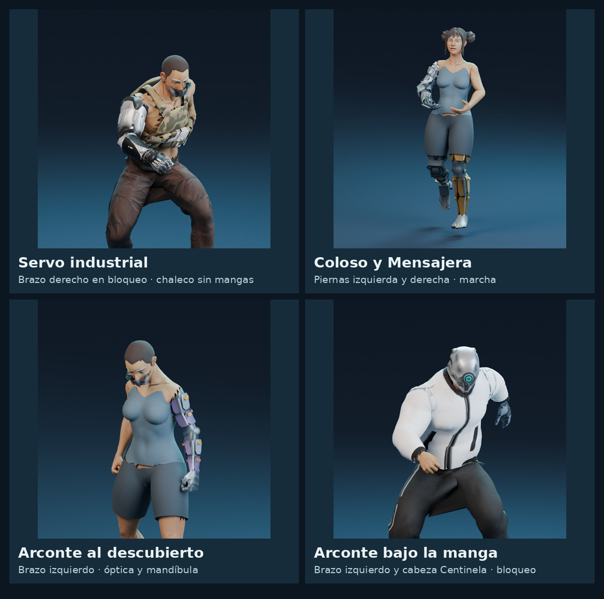

# Ciberware 3D de Vértice · v0.24

Los matasanos venden 21 implantes visibles. Hay ocho brazos completos, seis piernas, dos manos, una óptica monocular, un módulo de antebrazo, una mandíbula, una cabeza completa y una columna. Los dos cuerpos del creador tienen modelos propios. En las piezas pares se puede elegir el lado del personaje.

## Cómo probarlos

1. Usa **Iniciar en local** y entra con tu personaje. En Prótesis Ruiz hay recambios básicos. La Clínica Sato vende desde la gama común hasta la de lujo.
2. Habla con el matasanos y abre el catálogo. Pulsa **Instalar…**, selecciona **Lado del implante** cuando corresponda y confirma con **Operar**. La consulta indica el precio final, el riesgo, la capacidad y el coste en humanidad.
3. Abre la pestaña **Ciberware** de la pantalla de personaje para consultar la pieza y el lado. Prueba a cambiar de manga, caminar y bloquear. Al reconectar, la cuenta conserva el modelo y el lado intervenido.
4. Para probar la gama legendaria, visita la **Clínica Okami** o la **Consulta de Doc Yuki**. Las dos venden Arconte, Coloso y Titán.

## Catálogo y equilibrio

Los precios de la tabla son de catálogo. La clínica aplica las condiciones del mercado y añade la intervención. El color y el nombre de rareza se comparten con el resto del ciberware.

| Implante | Zona | Rareza y color | Precio base (€$) | Efectos |
| --- | --- | --- | ---: | --- |
| Mano de taller | Mano | Común · gris | 380 | +1 a Reparación |
| Pierna de encaje | Pierna | Común · gris | 440 | +1 a Atletismo |
| Brazo Circuito | Brazo | Poco común · verde | 1 950 | +3 kg de carga y +1 a Reparación |
| Mano de precisión Pinza | Mano | Poco común · verde | 2 200 | +2 a Reparación |
| Pierna Corredora | Pierna | Raro · azul | 5 900 | +4 % de velocidad y +1 a Atletismo |
| Brazo de tendones Biónica | Brazo | Raro · azul | 6 400 | +2 a Medicina y +2 puntos de probabilidad quirúrgica |
| Brazo de mensajería | Brazo | Raro · azul | 6 600 | +4 kg de carga y +8 % de daño cuerpo a cuerpo |
| Pierna de mensajería | Pierna | Raro · azul | 6 900 | +5 % de velocidad y +2 puntos de esquiva |
| Columna de discos Rótula | Columna | Raro · azul | 7 300 | +5 kg de carga y +5 de salud máxima |
| Óptica Centinela | Ojo | Raro · azul | 8 400 | +2 a Percepción y +1 a Armas |
| Mandíbula Mordaza | Mandíbula | Raro · azul | 6 800 | +2 a Intimidación y +1 de blindaje |
| Brazo Vigía | Brazo | Raro · azul | 8 500 | +1 de blindaje y +2 a Armas |
| Brazo Servo industrial | Brazo | De lujo · violeta | 18 600 | +1 a Cuerpo y +16 % de daño cuerpo a cuerpo |
| Pierna Grúa | Pierna | De lujo · violeta | 21 500 | +8 kg de carga y +2 de blindaje |
| Módulo de antebrazo Inductor | Módulo de antebrazo | De lujo · violeta | 20 100 | +18 % de daño cuerpo a cuerpo y +1 a Armas |
| Brazo Estibador | Brazo | De lujo · violeta | 24 000 | +10 kg de carga y +15 % de daño cuerpo a cuerpo |
| Brazo Bastión | Brazo | De lujo · violeta | 27 000 | +2 de blindaje y +12 de salud máxima |
| Cabeza integral Centinela | Cabeza completa | De lujo · violeta | 29 000 | +2 de blindaje y +2 a Percepción. Sustituye la cabeza completa |
| Brazo de asedio Arconte | Brazo | Legendario · dorado | 65 000 | +1 a Cuerpo, +30 % de daño cuerpo a cuerpo y +2 de blindaje |
| Pierna Coloso | Pierna | Legendario · dorado | 61 000 | +1 a Movimiento, +10 % de velocidad y +2 de blindaje |
| Pierna Titán | Pierna | Legendario · dorado | 69 000 | +1 a Cuerpo, +3 de blindaje y +14 kg de carga |

## Ajuste de cuerpo, ropa y movimiento

Los modelos de brazos y piernas siguen los huesos del hombro, codo, muñeca, cadera, rodilla y tobillo. La mano adicional puede sustituir a la incluida con el brazo. La escena oculta la piel sustituida, conserva la geometría del lado contrario y ajusta los volúmenes metálicos bajo las prendas. Los modelos de PNJ que tienen esqueleto propio reutilizan sus articulaciones.

Las imágenes son renderizados de prueba con los modelos, las prendas y las animaciones que usa el juego. Las fotos cubren los dos cuerpos del creador, un PNJ con uniforme y tres movimientos. Las comprobaciones automáticas cargan los 42 archivos GLB y verifican el lado anatómico, la unión al esqueleto y el ajuste bajo prendas.

| Imagen completa | Equipo | Animación |
| --- | --- | --- |
| [Brazo Servo y chaleco](ciberware/servo.jpg) | Servo derecho, Óptica Centinela izquierda y Mandíbula Mordaza | Bloqueo |
| [Piernas en movimiento](ciberware/coloso.jpg) | Coloso izquierda, pierna de mensajería derecha y brazo Circuito derecho | Marcha con carga |
| [Arconte con tirantes](ciberware/arconte.jpg) | Arconte izquierdo, Óptica Centinela derecha y Mandíbula Mordaza | Reposo |
| [Arconte con chaqueta](ciberware/abrigo.jpg) | Arconte izquierdo y Cabeza integral Centinela | Bloqueo |
| [PNJ policía y brazo Vigía](ciberware/policia.jpg) | Uniforme nativo del policía y Vigía derecho | Reposo sobre el esqueleto del PNJ |

La imagen del policía usa el personaje de *Vocations and Uniforms*, acreditado en [CREDITOS.md](../CREDITOS.md), y se distribuye con la licencia CC BY-SA del modelo.

## Inventario del release

Se inspeccionaron los 19 archivos de la [release ciberware](https://github.com/Cyberbug565/vertice/releases/tag/ciberware). Los cíborgs completos se dividieron en piezas equipables. Para los diseños propios, Vértice aporta geometría nueva. Los créditos de las mallas adaptadas están en [CREDITOS.md](../CREDITOS.md).

| Archivo recibido | Uso en Vértice |
| --- | --- |
| `atlas-g-arms.zip` | Diseño propio de Vértice · Brazo Estibador |
| `bionic-arm.zip` | Adaptación de malla para Brazo de tendones Biónica |
| `call-of-duty-iw-c6-robot-arms.zip` | Diseño propio de Vértice · Brazo Vigía |
| `cyber-girl.zip` | Adaptación de malla para Brazo de mensajería, Pierna de mensajería |
| `cybernetic_arms.glb` | Adaptación de malla para Brazo Circuito |
| `cyborg-weapon.zip` | Adaptación de malla para Módulo de antebrazo Inductor |
| `deception-soldier-arm.zip` | Diseño propio de Vértice · Brazo de asedio Arconte |
| `grimlock-leg.zip` | Diseño propio de Vértice · Pierna Coloso |
| `hand-for-the-robot.zip` | Adaptación de malla para Mano de precisión Pinza |
| `juggernaut-arm-hand-lr.1.zip` | Duplicado exacto de `juggernaut-arm-hand-lr.zip` (mismo SHA-256) |
| `juggernaut-arm-hand-lr.zip` | Diseño propio de Vértice · Brazo Bastión |
| `leg-prosthesis.zip` | Adaptación de malla para Pierna de encaje |
| `mech-leg.zip` | Adaptación de malla para Pierna Grúa |
| `megatron-leg.zip` | Diseño propio de Vértice · Pierna Titán |
| `robotic-hand.zip` | Diseño propio de Vértice · Mano de taller |
| `robotic-prosthetic-arm.zip` | Adaptación de malla para Brazo Servo industrial |
| `robotic-prosthetic-leg-final-assignment.zip` | Adaptación de malla para Pierna Corredora |
| `security-cyborg.zip` | Adaptación de malla para Cabeza integral Centinela, Mandíbula Mordaza, Óptica Centinela |
| `spine-implant-segment.zip` | Adaptación de malla para Columna de discos Rótula |
