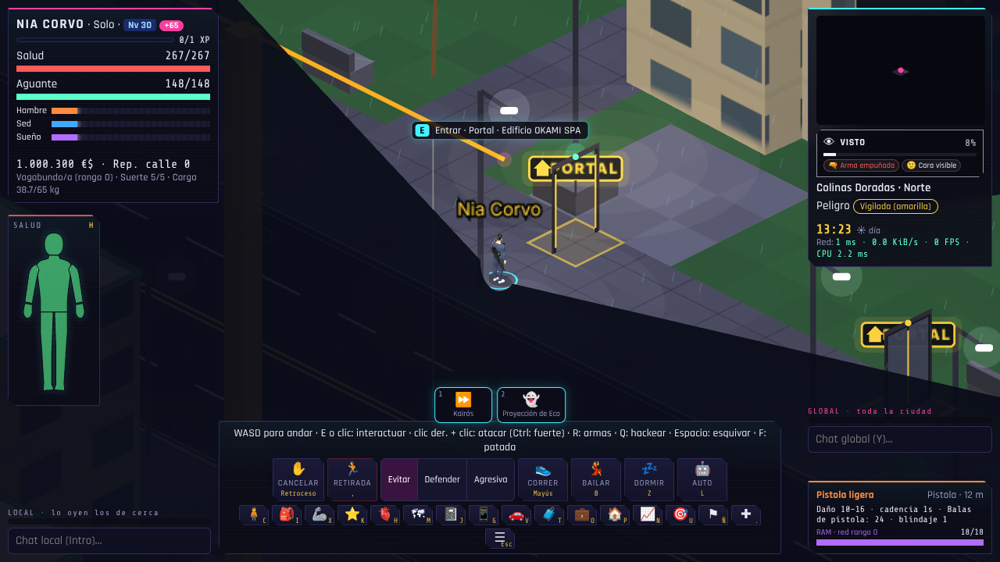
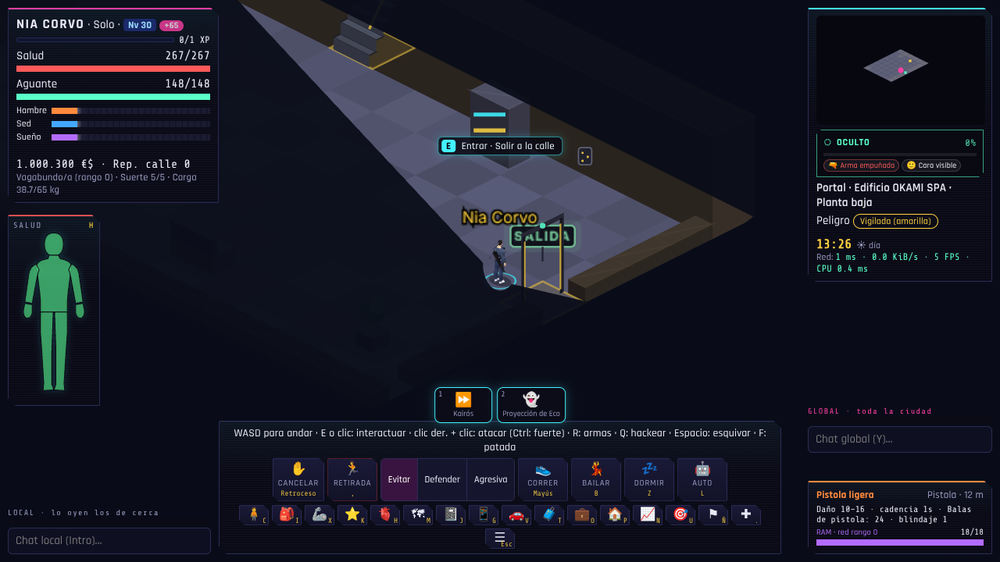
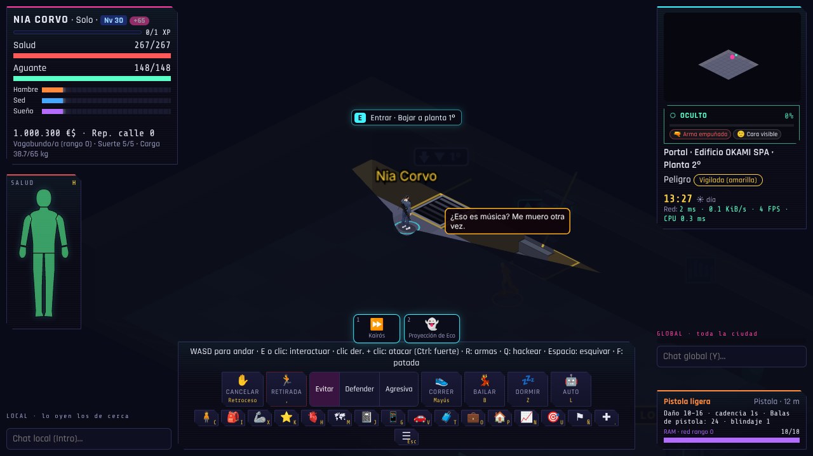
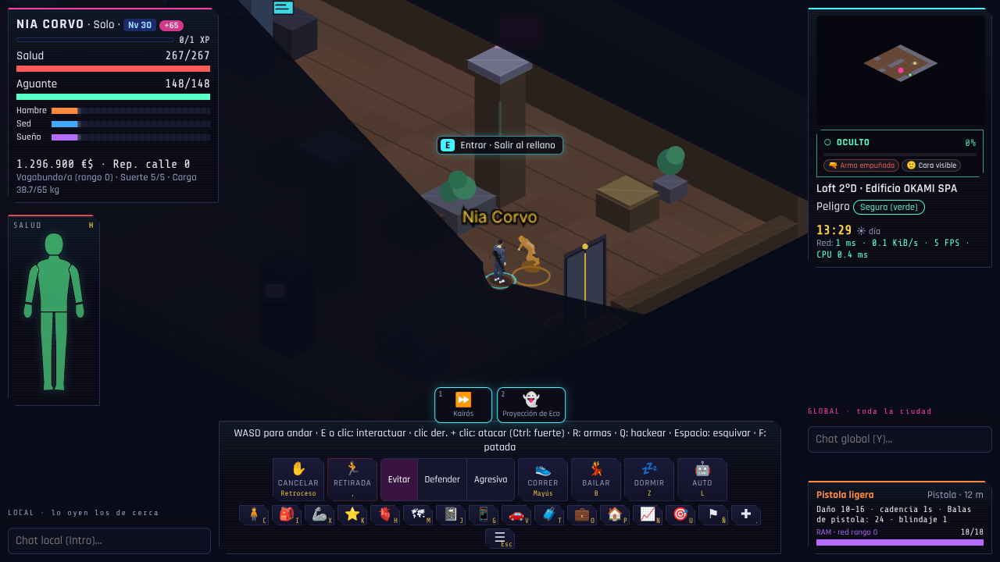
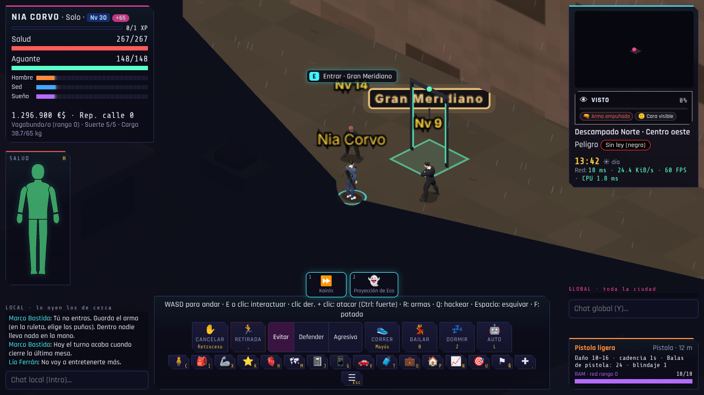
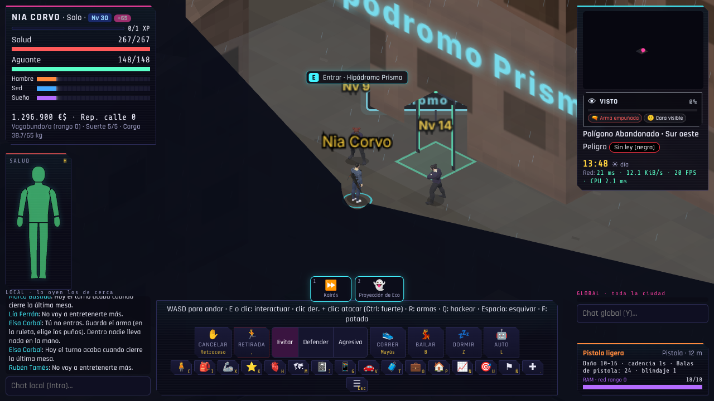
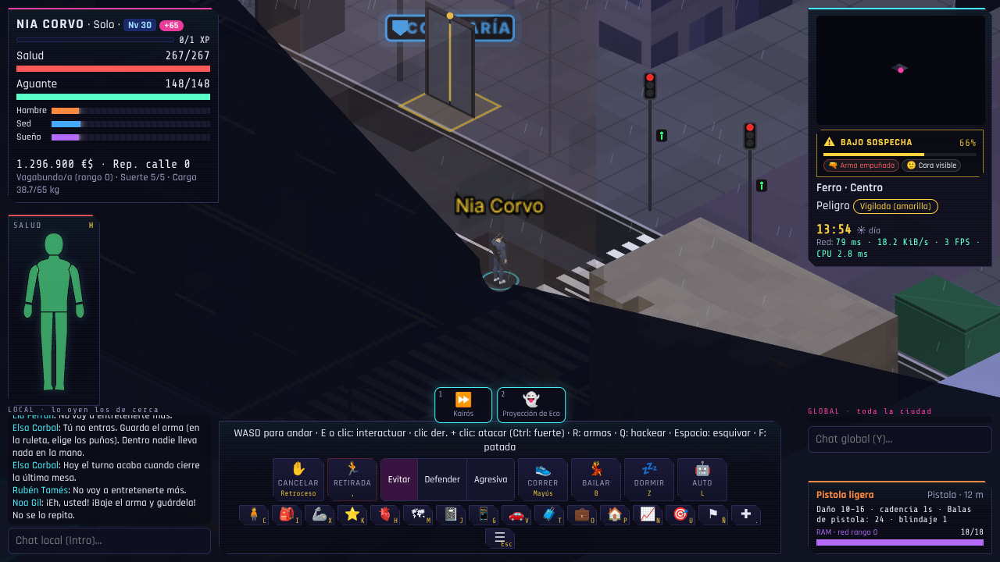

# Vértice v0.35: edificios por dentro y puertas sin pantallas de carga

## Portales de viviendas por dentro

Los 263 portales de la ciudad ya no abren un menú. Ahora son **puertas de verdad**, con su rótulo «PORTAL».

- **Vestíbulo (planta baja).** Tiene la salida a la calle, los buzones con el portero automático y la escalera de subida.
- **Escalera, planta a planta.** Cada rellano tiene tres cosas:
  - la escalera que baja, que se ve como un hueco con peldaños;
  - la escalera que sube, con peldaños hacia la pared, salvo en la última planta;
  - la **puerta de la vivienda** de esa planta, con su rótulo («2º · LOFT 2ºD»).
- **Tu piso.** La puerta del rellano se abre si es tuyo o tienes permiso. Si no, aparece el portero automático con la vivienda: si está en venta la puedes comprar y, si tiene dueño, llamar al timbre. Comprar desde el rellano también funciona, porque dentro del portal estás «en el portal».
- **Al salir de casa** apareces en el rellano de tu planta, no en la calle. Para salir a la calle hay que bajar a pie.
- **Casas sin escalera.** Los edificios con una sola vivienda, como las villas, no tienen vestíbulo: la puerta de la calle da directamente a la casa.
- **Más.** El panel del portero automático sigue permitiendo «Entrar» directamente, y el modo automático sube solo a su piso.

1.235 de las 1.284 viviendas están en edificios con escalera, repartidas en 214 portales de 2 a 8 plantas. En total son 1.449 plantas, incluidos los vestíbulos. Las otras 49 están en edificios de una sola vivienda y se entra desde la calle.

| | |
|---|---|
|  |  |
| Portal en la calle: puerta corredera abierta al acercarte | Vestíbulo: salida, buzones y escalera |
|  |  |
| Rellano de la 2ª planta | Tu piso; la puerta se cierra detrás de ti |

## Sin pantallas de carga: la puerta se abre y se cierra

- **Puertas correderas.** Todas las puertas se dibujan con su marco y dos hojas correderas. Se abren cuando alguien se acerca a menos de 1,7 m, sea un jugador o un PNJ, y se cierran detrás. El piloto se pone verde mientras están abiertas.
- **La ciudad no se reconstruye.** Al entrar en un interior, la ciudad que ya estaba dibujada se guarda tal cual: suelo, edificios 3D, rótulos, luces, tráfico y pasarelas. Al salir se vuelve a poner. Los coches siguen por donde iban.
- **Sin cartel.** Ya no sale «Entras en…» al cruzar una puerta; el nombre del sitio aparece en el panel de lugar. Solo hay aviso si entras en una zona peligrosa (roja o negra).
- **Puertas siempre visibles.** Las puertas y los objetos fijos se ven aunque queden fuera de tu campo visual, porque son parte del edificio. Antes, con la visión de la v0.33, una puerta a tu espalda desaparecía.

**Medida en el navegador**, con renderizado por software:

| Cambio de zona | Antes (reconstruir) | Ahora |
|---|---:|---:|
| Volver a la calle desde un interior | 740–830 ms | 44–76 ms (caché) |
| Calle → vestíbulo | — | 21–38 ms |
| Subir o bajar una planta | — | 1–5 ms |
| Rellano → piso | — | 2–5 ms |

## Porteros en los casinos grandes

En la puerta de **Gran Meridiano** y del **Hipódromo Prisma** hay siempre **dos porteros**. Hay cuatro por casino: dos de día (8:00–20:00) y dos de noche (20:00–8:00). Cuando te acercas a menos de 3 m, uno de ellos te dice en voz alta si vas a poder entrar.

- «Adelante. Suerte en las mesas.»
- «Tú no entras. Guarda el arma (en la ruleta, elige los puños).»
- «Sin camiseta no se entra.» / «En ropa interior, aquí no.»
- «Gran Meridiano exige un saldo mínimo de 50.000 €$.»

Si intentas cruzar igualmente, la puerta no se abre y el portero te repite el motivo. Si no queda ningún portero en su puesto (heridos, en pelea o de relevo), solo se aplican las normas del casino. Los vigilantes de dentro siguen como en la v0.28.

| | |
|---|---|
|  |  |

## Policía patrullando las comisarías

En cada una de las 5 comisarías hay ahora **dos agentes de la PCV por turno**, de 6:00 a 18:00 y de 18:00 a 6:00, que dan la vuelta a la manzana.

- Hacen un recorrido de 4 o 5 paradas en sentidos opuestos, así se cruzan.
- Al acabar el turno entran a redactar el parte y descansan dentro.
- Usan el reconocimiento y la persecución de la PCV: si llevas el arma en la mano delante de ellos, te dan el alto.

Son 20 agentes nuevos más los 8 porteros. En total la ciudad tiene 95 personas con horario, frente a las 67 de antes.

## Rendimiento del servidor con todos los edificios «abiertos»

Ninguna planta ni ninguna casa se guarda ni se simula mientras no la usa nadie.

- **Bajo demanda.** Cada planta se genera igual en el servidor y en el cliente a partir de las viviendas del edificio (`shared/src/residential.ts`), y el servidor solo la crea cuando alguien entra.
- **Se liberan solas.** Una planta o una casa vacía durante 60 s se libera; volver a entrar la recrea al instante.
- **No cuestan tick.** Las zonas vacías creadas así no se recorren en el tick.

Medida con `npx tsx scripts/medir-portales.ts`, el peor caso imposible: las 1.449 plantas y las 1.284 casas creadas a la vez.

| | Zonas | Tick medio | Memoria |
|---|---:|---:|---:|
| Normal | 134 | 0,21 ms | 63 MB |
| Las 2.733 plantas y casas creadas | 2.867 | 0,75 ms | 80 MB |
| Tras liberarlas | 134 | 0,15 ms | — |

El tick tiene 50 ms de margen (20 por segundo). Crear las 2.733 zonas a la vez cuesta 0,22 s; una sola, menos de un milisegundo.

**Por qué los interiores siguen siendo zonas aparte.** Los interiores no caben dentro de las huellas de sus edificios: 34 de 109 son más grandes que el edificio que los contiene. Meterlos en el mapa de la ciudad obligaría a rehacer todo el contenido y haría que el servidor simulara siempre a la vez la calle y todos los interiores. Con zonas aparte, una puerta que se abre y una ciudad guardada en el cliente, cruzar se ve igual de continuo y el servidor solo trabaja donde hay alguien.

## Técnico

- **Compartido:**
  - `residential.ts`: `portalZoneDef`, `portalZoneId`, `parsePortalZone`, `portalStreet` y las posiciones de puerta y escaleras;
  - `door` en el residente (portero);
  - el cliente usa `portalZoneDef` en `zoneDef`.
- **Servidor:**
  - `ensureZone` crea `portal:<edificio>:<planta>`;
  - la puerta del portal en la calle es una entidad puerta con `objKind: housing` y `objId`, para el timbre, la compra y el modo automático;
  - `exitOf` devuelve el rellano y `streetOf`, la calle;
  - `denyDoor`, para la puerta de una vivienda;
  - `collectZones` libera las zonas que llevan tiempo vacías, y el tick se salta las zonas bajo demanda vacías;
  - en `CityPeople`: `doormen`, `doorVerdict`, `doorDeny` y `watchDoors`;
  - `combat.weaponDrawn`.
- **Contenido:**
  - `content/npcs/porteros-patrullas.json`, generado con `npx tsx scripts/gen-v35-npcs.ts`, con posiciones transitables comprobadas.
- **Cliente:**
  - caché de escena por zona exterior en `view.ts` (`stash`/`unstash`) y en `chars3d.ts` (una `City3D` por exterior);
  - `Traffic.detach`/`attach`;
  - puertas correderas animadas;
  - escaleras de subida y de bajada;
  - iconos `subir`, `bajar` y `casa`.
- **Pruebas:**
  - `server/test/v35.test.ts`: todas las plantas se pueden recorrer, subir a pie hasta el piso, puerta cerrada para quien no tiene permiso, salir al rellano, liberación de zonas, villas, porteros y patrullas;
  - `casino.test.ts` y `turnos-npc.test.ts`, al día;
  - capturas: `e2e/shots-v35.ts`.
