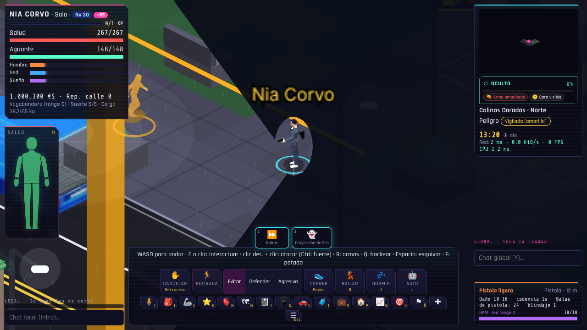
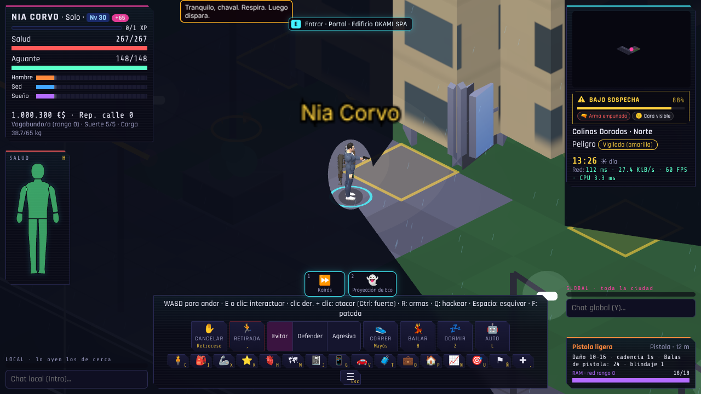
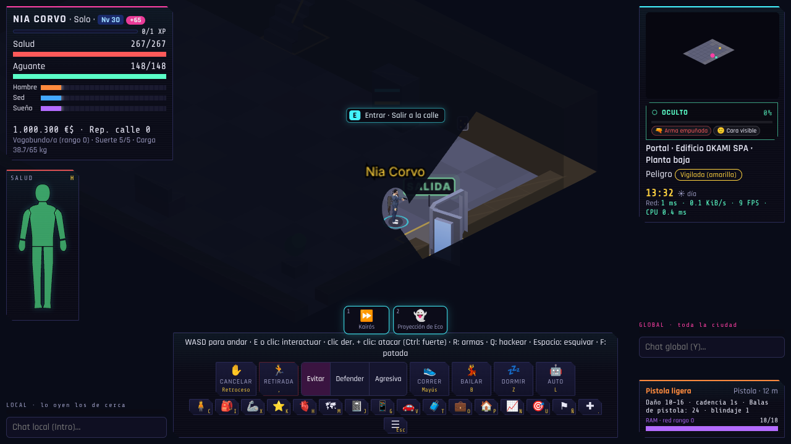
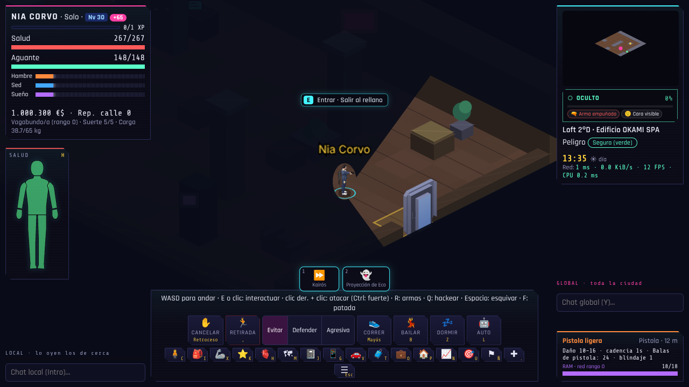
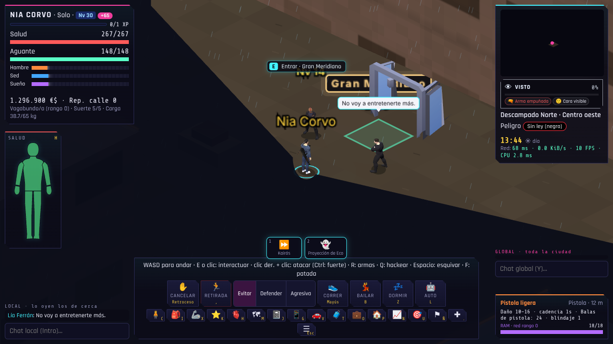
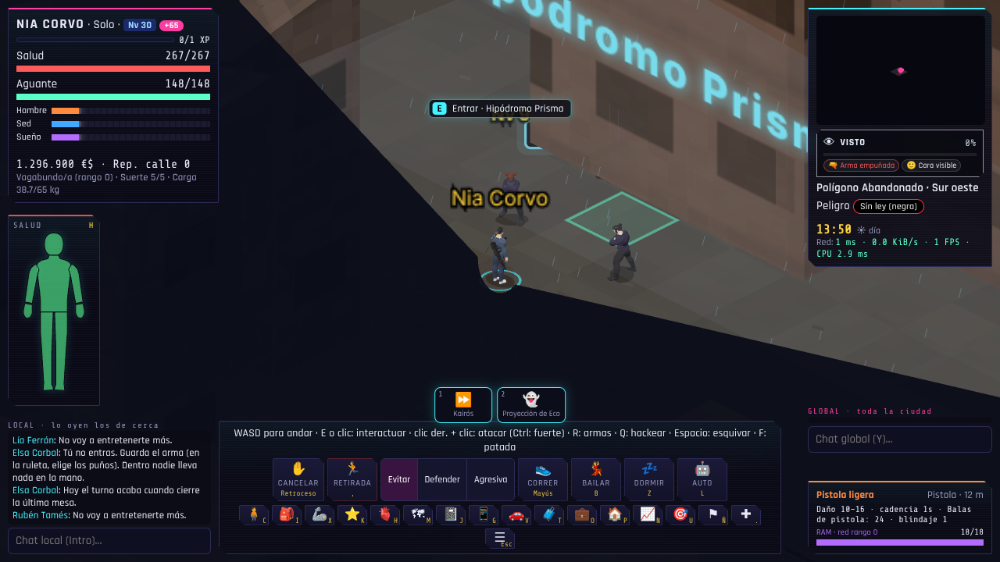

# Vértice v0.36: puertas de verdad en las fachadas

En la v0.35 las puertas eran un marco 2D dibujado en el centro de su casilla, a veces en mitad de la acera. Ahora cada puerta es **la puerta de un modelo de edificio**, encajada en el muro.

## De dónde salen las puertas

**Por qué no salen de los edificios de la ciudad.** Los edificios de la ciudad (los volúmenes de Manhattan de la release `newyork`) no tienen puertas: lo comprobé en el `.blend` y en el `.glb` originales, y no hay objetos ni materiales de puerta.

**De dónde salen.** Las que sí vienen modeladas son las de los edificios del kit **Kenney City Kit Commercial** (CC0), que ya estaba en el juego. `tools/puertas/extraer.py` (Blender) recorta dos de esas puertas, cada una en su marco y sus hojas por separado para poder abrirlas:

| Puerta | Sale de | Dónde se usa |
|---|---|---|
| Portal: una hoja con dos cristales y pomo | `building-c` | Portales de viviendas, puertas de piso y salidas de casas y rellanos |
| Tienda: dos hojas de cristal | `building-a` | Tiendas, bares, casinos, comisarías, clínicas y el resto de locales |

Están en `client/public/models/puertas/` y ocupan unos 17 KB cada una.

## Encajadas en el muro

- **En la calle:** para cada puerta se busca el edificio de al lado y, con un rayo contra el edificio 3D, a qué distancia está su pared de verdad (hay fachadas con retranqueos). La puerta se pone en esa pared, mirando a la calle.
- **Dentro:** va en el borde de la habitación por donde se sale.
- **Al acercarse alguien** (tú, otro jugador o un PNJ), las hojas giran hacia dentro sobre su bisagra, unos 77°, y se cierran cuando se aleja.
- **El rótulo** (PORTAL, el nombre del local…) sigue encima de la puerta.
- **Las escaleras al Nivel 2 y las de los portales** no son puertas y se siguen dibujando como escaleras.

## Portales recolocados

32 portales de viviendas se habían quedado sueltos en la acera o en un jardín, sin tocar ningún edificio. `tools/puertas/pegar-portales.ts` los ha llevado a la casilla de acera más cercana pegada a una fachada, buscando hasta 18 casillas alrededor. Ahora los 263 portales y todas las puertas de la calle, salvo las escaleras al Nivel 2, tocan su edificio. Lo comprueba `server/test/v36.test.ts`.

| | |
|---|---|
|  |  |
| Portal desde la calle | Al llegar, la hoja se abre hacia dentro |
|  |  |
| Salida del vestíbulo, abierta | Puerta del piso, cerrada |
|  |  |
| Puerta doble de cristal en Gran Meridiano | Hipódromo Prisma |

## Técnico

- **Cliente:**
  - `render/doors3d.ts`: carga los modelos, coloca cada puerta con su orientación y abre las hojas sobre la bisagra;
  - `chars3d.wallDistance`: el rayo contra los edificios 3D;
  - en `view.placeDoor3D`, la pared y el tipo de puerta;
  - las puertas y los portales ya no llevan caja que tape el edificio;
  - sin personajes 3D, se usa la puerta 2D de la v0.35.
- **Herramientas:** `tools/puertas/extraer.py` y `tools/puertas/pegar-portales.ts`.
- **Contenido:** 32 portales movidos en `content/zones/vertice.json`.
- **Créditos:** Kenney, CC0; la licencia está junto a los modelos.
