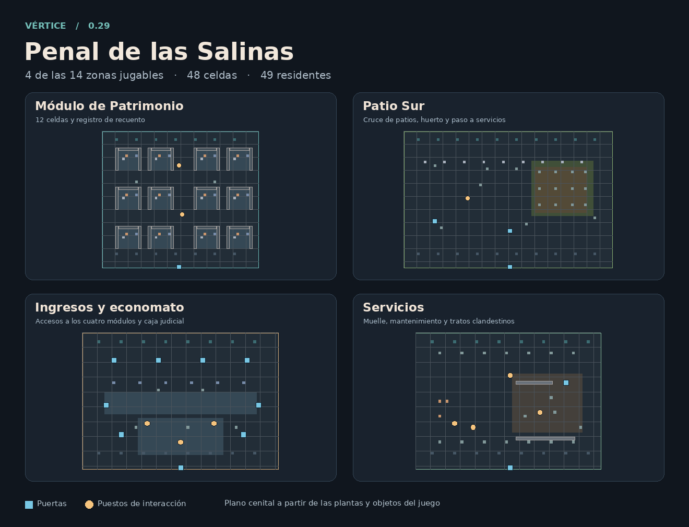

# Penal de las Salinas

La PCV ordinaria detiene al personaje cuando lo reduce. El ingreso traslada a una celda según el expediente. La visita pública se encuentra junto al Cementerio, en el edificio con el rótulo **Penal de las Salinas**.

## Expediente

| Delito | Días de juego | Módulo |
| --- | ---: | --- |
| Robo o hurto | 3–6 según reincidencia | Patrimonio |
| Fraude o estafa | 3–6 | Fraude |
| Contrabando | 3–6 | Patrimonio |
| Agresión | 4–7 | Violentos |
| Un homicidio | 5 | Violentos |
| Varios homicidios en la misma causa | 14 | Alta Seguridad |
| Quebrantamiento | 7–10 más el plazo pendiente | Alta Seguridad |

Cuando hay varios tipos de delito, el más grave fija el módulo. A la pena principal se pueden añadir hasta tres días por los demás tipos. Los homicidios nuevos cometidos en el penal alargan la condena activa. El reloj del servidor sigue avanzando durante la desconexión. Con la configuración predeterminada, un día de juego dura 90 minutos reales.

El ingreso requisa todo el efectivo y los objetos que llevas encima. El penal entrega un uniforme y cobra la multa de la cuenta bancaria. Con saldo insuficiente liquida implantes mejorados del personaje, aplica el 50 % de su precio al expediente y coloca equipo común compatible en el mismo lado o ranura. Los implantes míticos conservan las reglas de sus instancias únicas. El expediente conserva la deuda residual y la caja judicial permite hacer abonos. En un cajero de la ciudad puedes ingresar o retirar dinero de la cuenta.

## Rutina

- Hay cuatro módulos de doce celdas, dos patios, un taller, lavandería, comedor, enfermería, locutorios, ingresos, control y servicios.
- Los turnos autorizados son de 08:00 a 12:00 y de 18:00 a 21:00. El patio abre de 14:00 a 18:00 y las raciones se distribuyen de 06:00 a 08:00 y de 12:00 a 14:00.
- Trabajar aumenta la conducta. Hasta un 45 % del pago se aplica a la deuda. La revisión de libertad condicional exige un 65 % de condena, una conducta de al menos 75, tres turnos y ninguna sanción activa.
- La Salmuera y Los del Foso operan dentro del penal. Engranajes y Kitsune mantienen vínculos con la ciudad. Las alianzas obtenidas con los tratos pueden provocar represalias. La violencia y la muerte permanente funcionan en los módulos y patios.
- Las tres fugas del juego pasan por el contenedor de servicio, la obra clandestina o el panel de control. Una fuga activa una búsqueda y el siguiente arresto recupera el plazo pendiente. Los jugadores pueden abrir el expediente desde el botón del HUD.

## Referencias

La reincidencia y la revisión por conducta se inspiran en los artículos 22 y 90 del [Código Penal español](https://www.boe.es/buscar/act.php?id=BOE-A-1995-25444). La clasificación individualizada y la rutina toman elementos de los artículos 25, 26 y 63 de la [Ley Orgánica General Penitenciaria](https://www.boe.es/buscar/act.php?id=BOE-A-1979-23708). Los módulos por delito, los días, el sistema de confiscación y los implantes son reglas ficticias de Vértice.
